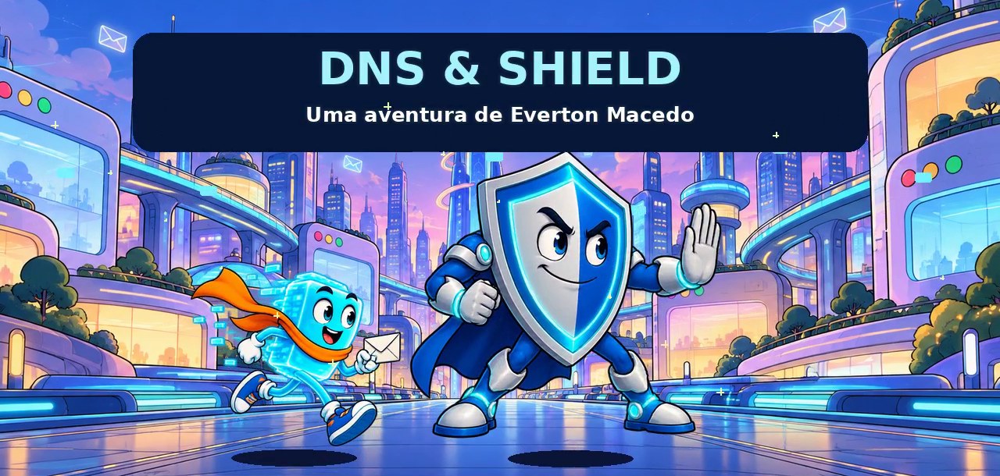
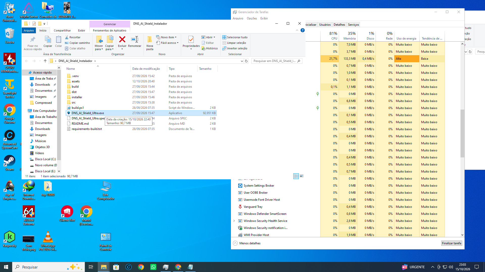
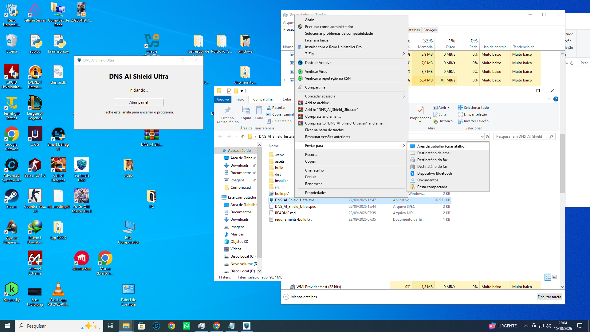
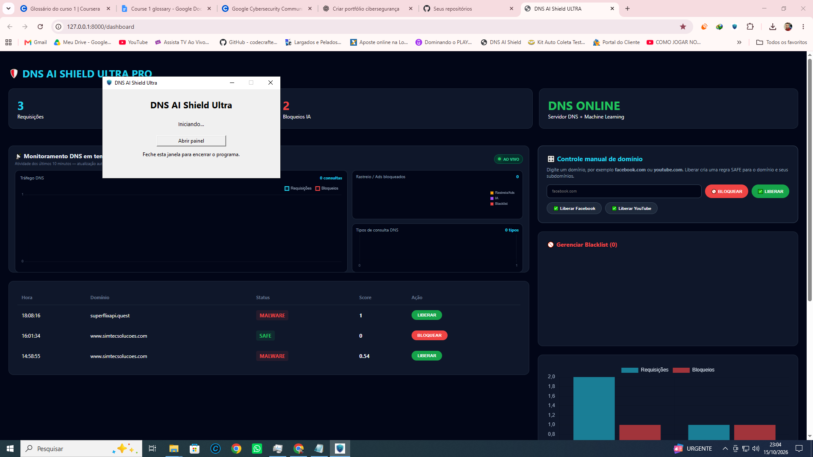
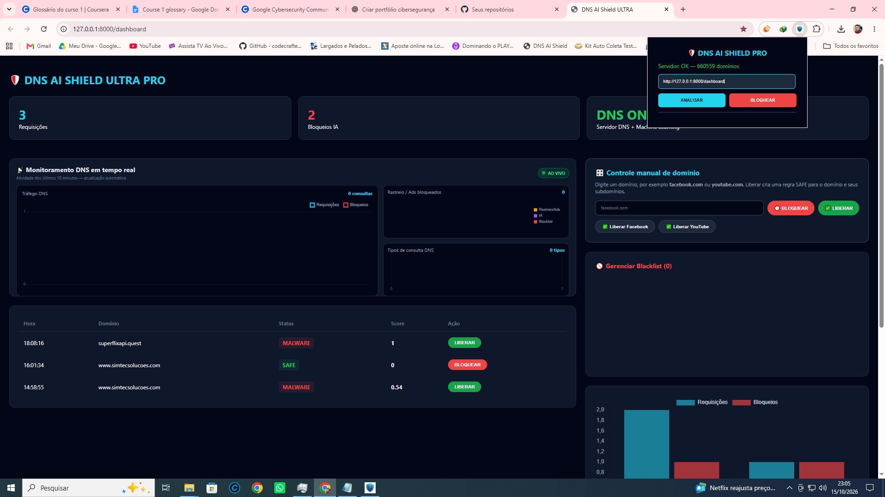
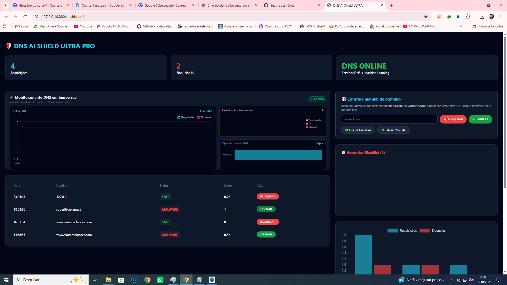

# DNS AI Shield Ultra

**Um projeto de Everton Macedo que reúne DNS, controle de domínios e uma extensão para o navegador.**

**[BAIXAR PROGRAMA + EXTENSÃO PARA WINDOWS](https://github.com/galegoww/portfolio-ciberseguranca/archive/refs/heads/dns-ai-shield-ultra.zip)**

[Ver o desenho animado](videos/desenho-dns-e-shield.mp4) · [Ver o tutorial rápido](videos/como-usar-no-windows.mp4) · [Ver as fotos](#o-programa-em-imagens)

## Começar em poucos passos

1. Baixe o pacote acima e **extraia todo o ZIP**.
2. Abra **DNS_AI_Shield_Ultra.exe** e aguarde iniciar.
3. Clique em **Abrir painel**. Mantenha a janela do programa aberta.
4. No Chrome, entre em `chrome://extensions` e ative **Modo do desenvolvedor**.
5. Clique em **Carregar sem compactação**, selecione a pasta **extensao** do pacote e abra a extensão para conferir **Servidor: OK**.

O pacote já inclui o EXE e os arquivos da extensão. Para usar essa versão, não é necessário instalar Python nem abrir um terminal. Para encerrar o serviço, feche a janela do programa.

**[Assistir ou baixar o vídeo de instalação — 3min08s](https://github.com/galegoww/portfolio-ciberseguranca/raw/refs/heads/dns-ai-shield-ultra/videos/como-usar-no-windows.mp4)**

## A aventura de DNS e Shield

Na cidade de Conexão, DNS trabalha levando mensagens até seus destinos. Tudo muda quando o Barão Pop-up decide cobrir o caminho com anúncios invasivos. É hora de chamar Shield e colocar ordem na bagunça!

Um curta de animação de recortes em 2D, com personagens originais, vozes em português, legendas, música e efeitos sonoros. Duração: **1min44s**.

**[Assistir ou baixar o desenho animado](https://github.com/galegoww/portfolio-ciberseguranca/raw/refs/heads/dns-ai-shield-ultra/videos/desenho-dns-e-shield.mp4)**

[Leia a história completa](historia/historia.md) · [Legendas em português](historia/legendas-desenho.srt) · [Créditos e criação](historia/creditos-e-criacao.md)

O desenho é uma fantasia inspirada no projeto. Os personagens não representam uma demonstração técnica do software.

## O programa em imagens

### O executável

### Janela de início e botão Abrir painel

### Dashboard aberta

### Extensão conectada

### Visão da dashboard

As capturas foram fornecidas pelo autor. Os números exibidos são os daquele momento e não constituem uma validação de bloqueio ou reputação de todos os domínios.

## Personagens e artes

- **DNS:** o mensageiro que conhece os caminhos da cidade.
- **Shield:** o guardião que entra em ação contra os anúncios invasivos da história.
- **Barão Pop-up:** o vilão que aparece quando ninguém o chamou.

[Ver o cenário da cidade de Conexão](artes/cidade-conexao.png)

## Sobre esta versão

Esta publicação reúne o programa Ultra enviado pelo autor, a extensão original 1.7 e os materiais de apresentação aprovados. O histórico inicial embutido no EXE foi removido da cópia pública. Os arquivos de código e bibliotecas do executável foram preservados.

**A cópia pública do EXE ainda não foi executada em Windows neste ambiente.** A extensão original aplica até 5.000 regras; o total do banco não equivale ao número de bloqueios confirmados. O modelo é experimental, e seus rótulos não comprovam presença de malware. O programa não muda automaticamente o DNS do Windows.

[Notas da versão e conferências realizadas](NOTAS-DA-VERSAO.md) · [Instruções em texto](COMECE-AQUI.txt) · [Hashes dos arquivos](SHA256.json) · [Fontes de referência](fontes/)

---

Projeto de **Everton Macedo** · [Meu portfólio de segurança cibernética](https://github.com/galegoww/portfolio-ciberseguranca)
